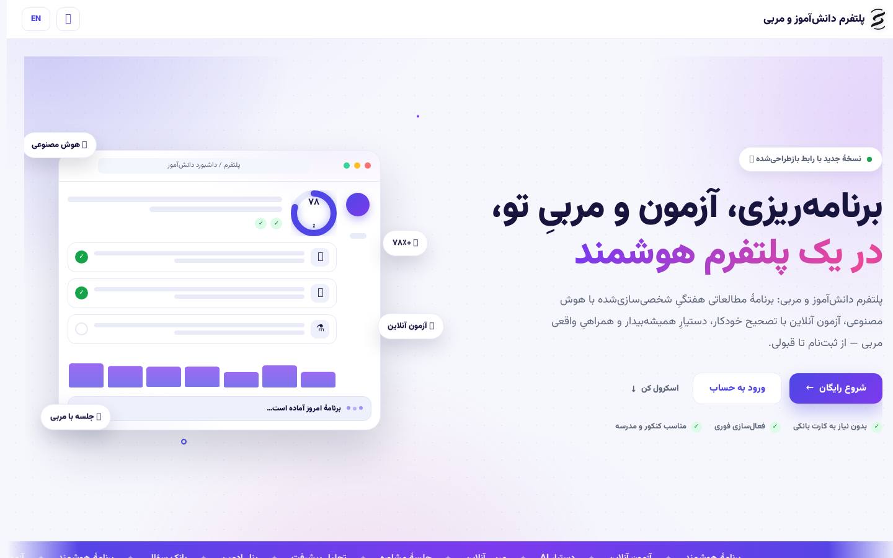
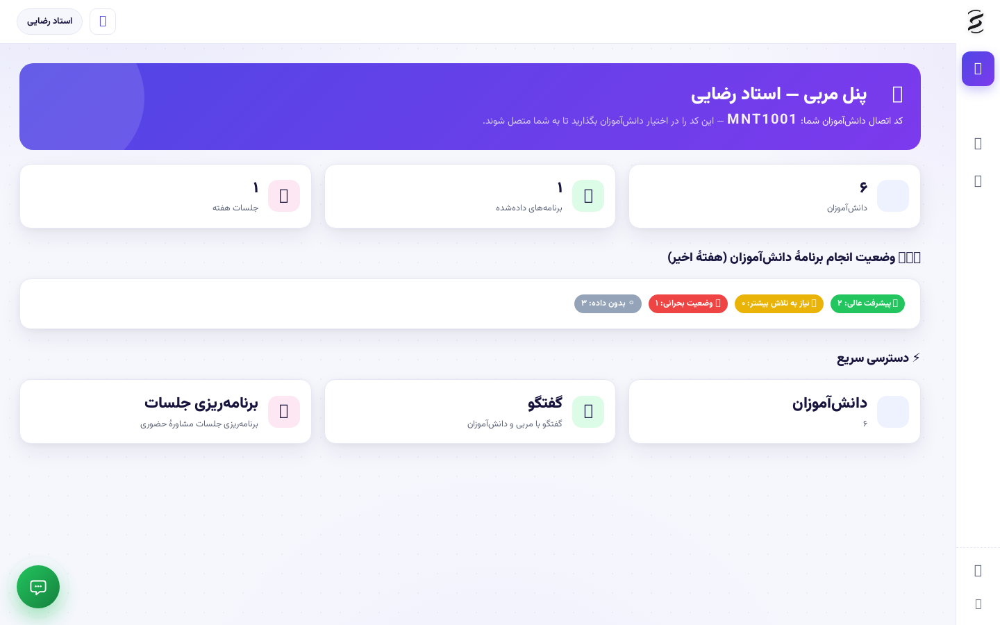
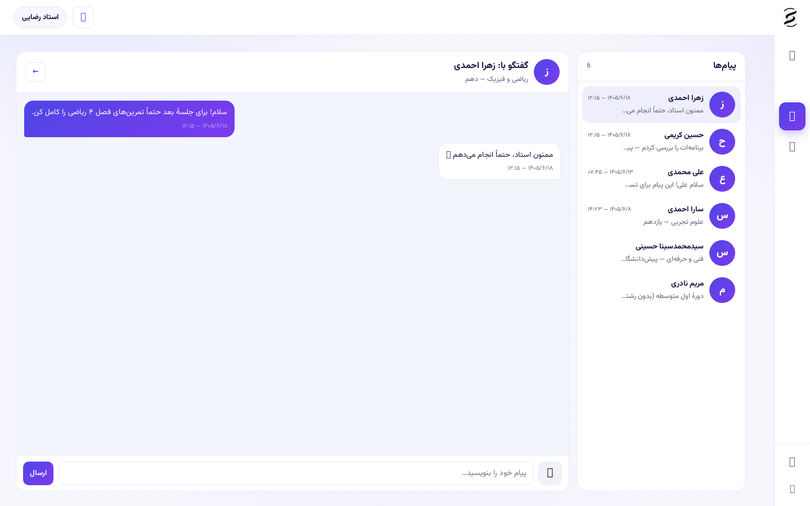
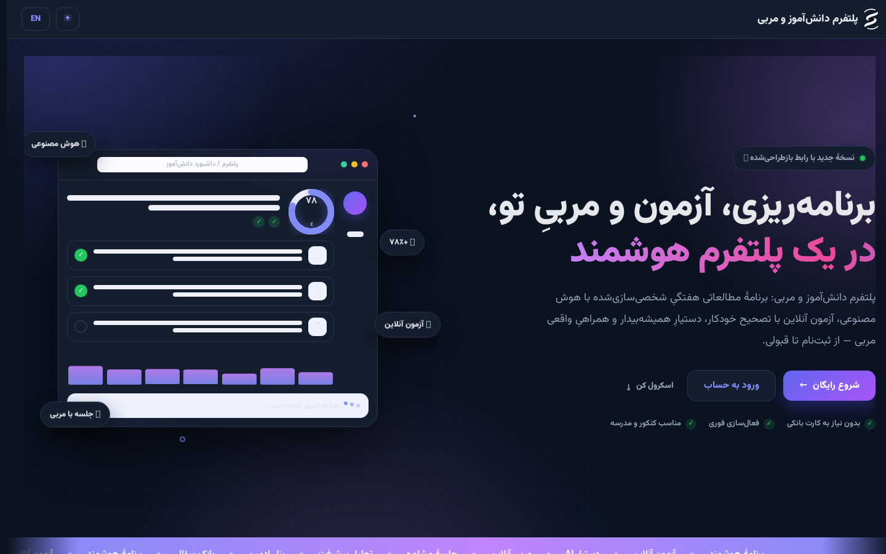
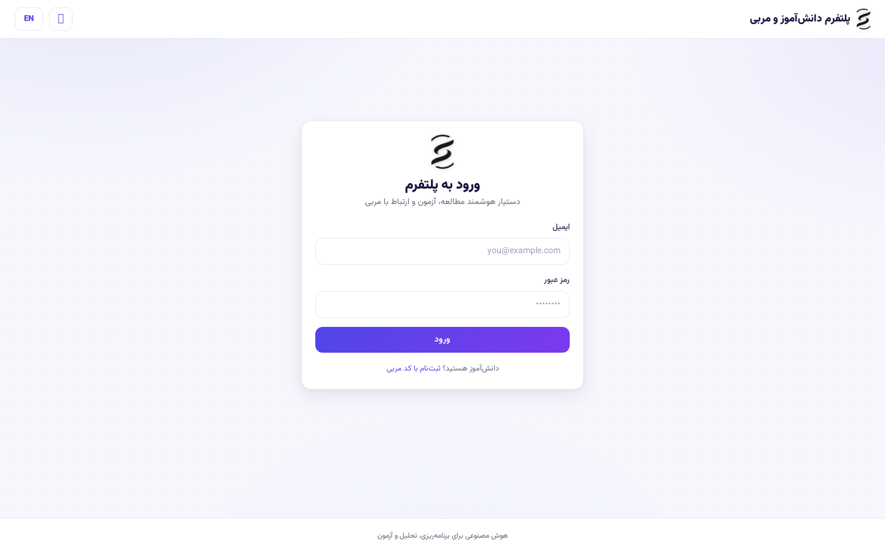

<div align="center">

# 🧠 Synapse | سیناپس
### Intelligent Adaptive Academic Mentorship & Cognitive Study Orchestration Platform

[](https://github.com/seyedmohammadsinahosseini/synapse/actions)
[](https://www.python.org/)
[](https://fastapi.tiangolo.com/)
[](https://react.dev/)
[](https://vitejs.dev/)
[](https://opensource.org/licenses/MIT)

<p align="center">
  <b>A full-stack, research-driven educational platform bridging AI-powered cognitive diagnostics, real-time mentor supervision, and continuous 30-day personalized study matrix planning.</b>
</p>

[Key Features](#-key-features) • [System Architecture](#-system-architecture) • [UI & HCI Gallery](#-visual-gallery--hci-showcase) • [Tech Stack](#-technical-stack) • [Quick Start](#-quick-start-guide) • [API & Security](#-security--defensive-engineering) • [Author](#-author)

</div>

---

## 📸 Visual Gallery & HCI Showcase

<div align="center">

### 1. Modern Desktop Landing & Dynamic Showcase


---

### 2. Mentor Supervision Dashboard & Academic Analytics


---

### 3. Real-Time WebSocket Consultation & Audio Messaging


---

### 4. Interactive Dark Mode & Celestial Theme Engine


---

### 5. Multi-Step Academic Onboarding & Goal Profiling


</div>

---

## 🌟 Key Features & Engineering Highlights

### 🧠 1. Cognitive AI Diagnostics & Academic SWOT Engine
- **Automated Diagnostic Dossier:** Generates instant academic SWOT evaluations based on historical exam percentages, target goals, and study habits.
- **Dynamic Question Generator:** Multi-format question synthesis (Multiple-Choice, Essay, Conceptual) with automated answer keys, difficulty curves, and batch JSON/Excel imports.
- **Semantic Exam Auto-Grading:** Real-time grading of objective questions combined with AI semantic evaluation for descriptive essay solutions.

### 🗓️ 2. Continuous 30-Day Monthly Study Planner Matrix
- **Continuous Calendar Matrix:** A full 30-day horizontal study planning grid supporting smooth mouse drag-to-scroll, swipe navigation, and jump-to-today shortcuts.
- **Mentor Drag-and-Drop Authoring:** Exclusive mentor controls for assigning, reordering, and balancing daily study slots, with automated capacity overload alerts (>12h daily limits).
- **Task Reveal Mechanics:** Clean distraction-free card views hiding notes until clicked, paired with integrated Pomodoro timers syncing exact mentor-assigned durations.

### 🎨 3. Advanced HCI & Reactive Design System
- **6 Dynamic Structural Skin Transformations:**
  1. **Default Modern:** Clean, modular, high-contrast interface.
  2. **Frutiger Aero:** Skeuomorphic glossy aero water and sky aesthetics with glassmorphic cards.
  3. **Windows XP Classic:** Authentic Luna blue headers, Bliss hill backgrounds, and classic beveled frames.
  4. **Cyber Chrome Y2K:** Brushed metallic surfaces, neon green/cyan cyber accents, and digital future layouts.
  5. **Neo Pop Retro:** Chunky brutalist borders, vivid pop colors, and playful retro geometry.
  6. **Liquid Glass:** Live SVG optical displacement refraction filters (`#rava-glass-refraction`), frosted blur, and cursor lighting.
- **Emil Kowalski Spring Physics:** Micro-interactions utilizing custom cubic-bezier curves for popovers, checkmarks, modals, and drag cards.

### 💬 4. Real-Time Consultation & Voice Note Messaging
- **Bi-directional WebSockets:** Instant text messaging and presence synchronization between mentors and students.
- **Audio Voice Notes:** Browser-based voice recording and playback with binary magic-byte header validation on upload.
- **Atomic Slot Reservation:** Automated booking manager for 45-minute consultation windows with conflict-free scheduling.

---

## 🛠️ System Architecture

```text
┌────────────────────────────────────────────────────────────────────────┐
│                        Synapse Frontend (React 18 + Vite)              │
│  ┌───────────────────────┐ ┌──────────────────────┐ ┌───────────────┐  │
│  │ Study Planner Matrix  │ │ AI Diagnostic Studio │ │ Appearance    │  │
│  │ (30-Day Drag Matrix)  │ │ (SWOT & Question Gen)│ │ Studio Engine │  │
│  └───────────┬───────────┘ └──────────┬───────────┘ └───────┬───────┘  │
└──────────────┼────────────────────────┼─────────────────────┼──────────┘
               │ REST API (JSON)        │ WebSocket (/ws)     │ State (JWT)
┌──────────────▼────────────────────────▼─────────────────────▼──────────┐
│                        FastAPI Backend Engine (Python 3.12)            │
│  ┌──────────────────────────────────────────────────────────────────┐  │
│  │ Middleware: Sliding-Window Rate Limiter & RBAC Security Engine   │  │
│  └──────────────────────────────────────────────────────────────────┘  │
│  ┌─────────────────┐ ┌──────────────────┐ ┌─────────────────────────┐  │
│  │ Plan & Matrix   │ │ AI Diagnostic    │ │ Consultation & Voice    │  │
│  │ Router          │ │ Service (OpenAI) │ │ WebSocket Manager       │  │
│  └────────┬────────┘ └────────┬─────────┘ └───────────┬─────────────┘  │
└───────────┼───────────────────┼───────────────────────┼────────────────┘
            │                   │                       │
┌───────────▼───────────────────▼───────────────────────▼────────────────┐
│                       Data Persistence & Storage                       │
│     • SQLite / PostgreSQL (SQLAlchemy ORM + Pydantic v2 Models)        │
│     • ReportLab PDF Analytical Dossier Generation                      │
│     • Secure Media Storage (Sanitized Magic-Byte Binary Headers)       │
└────────────────────────────────────────────────────────────────────────┘
```

---

## 💻 Technical Stack

| Layer | Technologies |
|---|---|
| **Frontend Core** | React 18, Vite 5, JavaScript (ES2024), React Hooks |
| **Styling & HCI** | Custom CSS3 Custom Properties, SVG Optical Refraction Filters, Web Audio Synth API |
| **Backend Framework**| Python 3.10+, FastAPI, Starlette, Uvicorn (ASGI) |
| **Database & ORM** | SQLAlchemy 2.0, SQLite (Zero-config) / PostgreSQL compatible |
| **Data Validation** | Pydantic v2 with strict schemas and email validation |
| **Security & Auth** | PyJWT (HMAC-SHA256), Passlib & Bcrypt (120k rounds), Sliding-Window Rate Limiting |
| **Real-time Services**| WebSockets (WSS), Asyncio broadcast event loops |
| **Document Engine** | ReportLab 5.0 (Automated Academic Dossier PDF generation) |
| **Testing & CI/CD** | Pytest, HTTPX TestClient, GitHub Actions Automated CI |

---

## 🚀 Quick Start Guide

### Prerequisites
- **Python:** `3.10` or higher
- **Node.js:** `18.x` or higher & `npm`

---

### 1. Clone & Set Up Environment

```bash
git clone https://github.com/seyedmohammadsinahosseini/synapse.git
cd synapse
```

### 2. Backend Installation & Initialization

```bash
# Optional: Create and activate virtual environment
python -m venv .venv
source .venv/bin/activate  # On Windows: .venv\Scripts\activate

# Install backend dependencies
pip install -r backend/requirements.txt

# Start FastAPI server
python start_backend.py
```
*API server will launch on `http://localhost:8000` (Swagger interactive docs available at `http://localhost:8000/docs`).*

### 3. Frontend Installation & Launch

```bash
cd frontend
npm install
npm run dev
```
*Web application will be accessible at `http://localhost:5173`.*

---

## 🔑 Pre-Seeded Demonstration Accounts

| Role | Username / Email | Password | Permissions & Scope |
|---|---|---|---|
| **Admin** | `admin@panel.test` | `admin123` | Global analytics, Question Bank management, User CRUD |
| **Mentor** | `mentor@panel.test` | `mentor123` | Student supervision, 30-day planner authoring, Chat |
| **Student** | *(Self-register via UI)* | *(Custom)* | Personal 30-day plan, Pomodoro, Exam engine, AI Chat |

---

## 🛡️ Security & Defensive Engineering

1. **Zero Hardcoded Credentials:** 100% environment-driven configuration via `.env`.
2. **Defensive Rate Limiting:** Sliding-window rate limiting on sensitive authentication and AI completion endpoints.
3. **Magic-Byte Binary Validation:** Uploaded voice notes and profile avatars are validated against true binary headers (preventing arbitrary script uploads).
4. **Role-Based Access Control (RBAC):** Strict JWT claims enforcement ensuring students cannot modify official mentor study plans or access restricted question banks.

---

## 🧪 Testing & Quality Assurance

Run the comprehensive integration and unit test suite:

```bash
pytest -v
```

```text
======================== 6 passed, 32 warnings in 1.48s ========================
```

---

## 📄 License

This project is licensed under the **MIT License** — see the [LICENSE](LICENSE) file for details.

---

## 👨‍💻 Author

**Seyed Mohammad Sina Hosseini**
- GitHub: [@seyedmohammadsinahosseini](https://github.com/seyedmohammadsinahosseini)
- Project Repository: [https://github.com/seyedmohammadsinahosseini/synapse](https://github.com/seyedmohammadsinahosseini/synapse)
